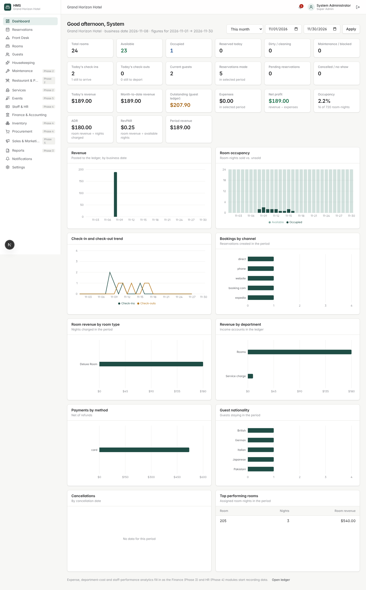

# Hotel Management System

A production-oriented hotel management platform: reservations, front desk, rooms, guests, housekeeping and a double-entry ledger, built on one PostgreSQL database so every action updates every connected module.

**Status: Phases 1–5 are implemented** (core operations; maintenance, services, restaurant POS and kitchen display; full accounting and reports; HR, payroll, inventory and procurement; booking engine, OTA channels, CRM/loyalty, events, revenue management and the group dashboard). Phase 6 (hardening and deployment) remains. See [docs/ARCHITECTURE.md](docs/ARCHITECTURE.md) for the full-system design, schema, RBAC model and workflows, and the phase plan.

## Screenshots

| Dashboard | Room board |
|---|---|
|  |  |

| Reservation calendar | Check-out |
|---|---|
|  |  |

## What works today

| Area | Highlights |
|---|---|
| Auth & security | bcrypt passwords, DB-backed sessions (hashed tokens, HttpOnly cookies, 12h sliding expiry), login rate limiting and lockout, forced password change, session revocation, full audit log |
| RBAC | 19 built-in roles, custom roles, module × action permission matrix plus special permissions (ID documents, financial figures, discounts, refunds, balance check-out), multiple roles per user, per-property access |
| Dashboard | Room, front-desk, reservation and finance KPIs; occupancy, ADR, RevPAR; revenue, occupancy, movement, channel, room-type, department, payment-method, nationality, cancellation and top-room analytics. All from live records and the ledger; widgets shown by permission |
| Rooms | Room types, occupancy rules, extra-person charges, amenities, seasonal/weekend/holiday/promotional rates, single and bulk room creation, live status board, room history, block / maintenance with date ranges |
| Reservations | Live availability and pricing, group bookings, returning-guest matching, deposits, discounts, edit, change dates / extend / shorten, assign or move rooms, cancellation with refund + retained fee, no-show, booking history, printable confirmation, room-wise and room-type-wise calendar with drag-and-drop |
| Front desk | Arrivals, departures, in-house, unassigned rooms, guest requests, walk-in, check-in with ID verification and ready-room enforcement, check-in receipt, night audit, exact check-out preview, partial payment / allowed balances, overpayment refunds, invoice |
| Guests | Profiles, VIP, categories, segments, stay and payment history, preferred room type, ID documents restricted to authorised roles (views are audited) |
| Housekeeping | Automatic task on check-out, assignment, start → cleaned → inspection → available |
| Finance | Every money movement posts a balanced journal entry; trial balance and journal view |
| Staff & HR | Employee profiles (departments, job, employment type, optional system login), salary/bank/ID details restricted to `hr.view_sensitive`, departments, shifts (incl. overnight) and weekly roster, attendance with late/overtime from the shift, close-the-day absence marking, leave types with yearly entitlements, balance checks and approval, staff self-service (clock in/out, leave requests, payslips) |
| Payroll | Monthly runs calculated from salary, days employed, unpaid leave, absences and overtime; per-employee allowances and withholding; approval posts Dr Salaries & Wages / Cr Salaries Payable / Cr Taxes Payable, payment posts Dr Salaries Payable / Cr Bank or Cash; approved periods lock attendance and leave; printable payslips |
| Maintenance | Work orders with priority, assignment, room out-of-order linkage, cost posting (cash or on account), preventive schedules, lost & found |
| Services | Laundry/spa/transport/other catalog; orders charged to the room folio or paid on the spot |
| Restaurant POS | Outlets, tables and floor plan, menu with stations, open/send/settle orders, pay now or charge to room, service charge and tax, room service |
| Kitchen display | Live per-station ticket board (auto-refresh) with new → preparing → ready → served |
| Accounting | Chart of accounts, manual journals, reversals, expenses (cash/bank/on account), AR and AP ageing, supplier bill payments, P&L, balance sheet, trial balance, budgets vs actual, period close (enforced in code and by a DB trigger) |
| Reports | Daily KPIs, sources, revenue, POS, services, financial statements, ageing, inventory, maintenance, feedback; CSV export (audited, needs export permission) |
| Inventory | Items, locations, receive/issue/transfer/adjust with moving-average cost, low-stock alerts, movement history, all posted to the ledger |
| Procurement | Purchase requests → approval → purchase orders → goods receipt (updates stock, raises supplier bill) → payment |
| Booking engine | Public `/book`: search, live pricing, coupon codes, marketing consent; bookings arrive as pending website reservations |
| Channels | OTA channel setup and room-type mappings; signed webhook at `/api/public/ota/[channel]`; sync is logged as not configured until real API keys exist |
| CRM | Loyalty tiers with points earned on check-out and redeemable as folio discounts, coupons, segmented campaigns, guest feedback and complaints |
| Events | Venues, event bookings with capacity and overlap checks, items, deposits, own folio, invoicing and settlement |
| Revenue management | Competitor rates and occupancy-based rate suggestions that can be applied as one-night promotional rates |
| Group overview | Consolidated KPIs across every property the user can access |

## Integrity guarantees

- **No double booking:** a PostgreSQL exclusion constraint on `(room, daterange)` plus a per-property advisory lock around availability checks.
- **Balanced books:** `postJournal` rejects unbalanced entries, and a deferred database trigger rejects any unbalanced entry at commit.
- **Immutable ledger:** database triggers block UPDATE/DELETE on posted lines; corrections are reversals.
- **No duplicates:** idempotency keys on bookings, check-ins, check-outs and payments; unique `(source_type, source_id, purpose)` on journal entries.
- **Atomic workflows:** each workflow (e.g. check-out: charges → discount → deposits → payment → invoice → room dirty → housekeeping task) runs in one transaction.
- **No fake integrations:** email/SMS/OTA/payment gateway are recorded as "not configured" until real credentials exist.

## Running locally

Requires Node 20+ and PostgreSQL 14+ (with the `btree_gist` extension, included in standard PostgreSQL).

```bash
npm install
cp .env.example .env            # set DATABASE_URL
npx prisma migrate deploy
npm run db:seed                 # roles, permissions, chart of accounts, rooms, admin user (+ demo data)
npm run dev
```

### Running without a database

If `DATABASE_URL` is not set (for example a plain Vercel deploy), the app starts a built-in in-memory PostgreSQL (PGlite), creates the schema and loads the demo hotel, so every page works with no setup. Data lives in server memory: changes you make are kept while the server stays warm and reset to the demo data after it restarts. Set `DATABASE_URL` to use a real PostgreSQL database and keep data permanently.

### Default logins

The seed creates these users, all with the password `passpass@123` (set `SEED_DEFAULT_PASSWORD` to use a different one):

| Email | Role |
|---|---|
| `admin@hms.com` | System Administrator |
| `gm@hms.com` | General Manager |
| `frontdesk@hms.com` | Receptionist |
| `housekeeping@hms.com` | Housekeeping Manager |
| `accounts@hms.com` | Accountant |
| `hr@hms.com` | HR Manager |
| `restaurant@hms.com` | Restaurant Manager |
| `maintenance@hms.com` | Maintenance Manager |
| `stores@hms.com` | Inventory Manager |
| `sales@hms.com` | Sales & Marketing Manager |

Change these passwords before using the system with real guests. Set `SEED_DEMO=false` to skip demo data. Demo records are flagged `isDemo` and labelled "Demo" in the UI.

The public booking engine is at `/book` (no login). Demo coupons: `WELCOME10`, `STAY3SAVE50`. Demo staff are linked to these logins, so each can use **My Time & Leave**.

Optional integrations stay off (and say so) until configured: `OTA_WEBHOOK_SECRET` (enables the OTA webhook), `OTA_<CHANNEL>_API_KEY` (e.g. `OTA_BOOKING_COM_API_KEY`, enables channel sync), `EMAIL_PROVIDER` / `SMS_PROVIDER` (campaign delivery).

## Tests

The workflow tests run against a real PostgreSQL database and **truncate it**, so they refuse to run unless the database name ends in `_test`:

```bash
createdb hms_test
DATABASE_URL=postgresql://…/hms_test npx prisma migrate deploy
DATABASE_URL=postgresql://…/hms_test npm test
```

They cover double-booking (including the DB constraint), type-level sell-out, idempotency, the full stay with exact ledger balances, early departure, walk-in, extension conflicts, cancellation refunds, room moves across types, ledger immutability, payroll, POS (paid and charged to room), services, inventory costing and counts, PO → receipt → bill → payment, expenses, manual journals, period close, event overlap and billing, loyalty earn/redeem, and coupons through the booking engine.

## Layout

```
prisma/              schema, migrations (incl. SQL constraints & triggers), seed
src/server/services  domain logic: availability, pricing, reservations, front desk, folio, ledger, rooms, dashboard
src/server/actions   server actions: auth → permission → Zod validation → service, in one transaction
src/server/auth      sessions, passwords, permission catalogue, request context
src/app              pages (App Router)
src/components       UI primitives and module components
docs/ARCHITECTURE.md full-system design
```
