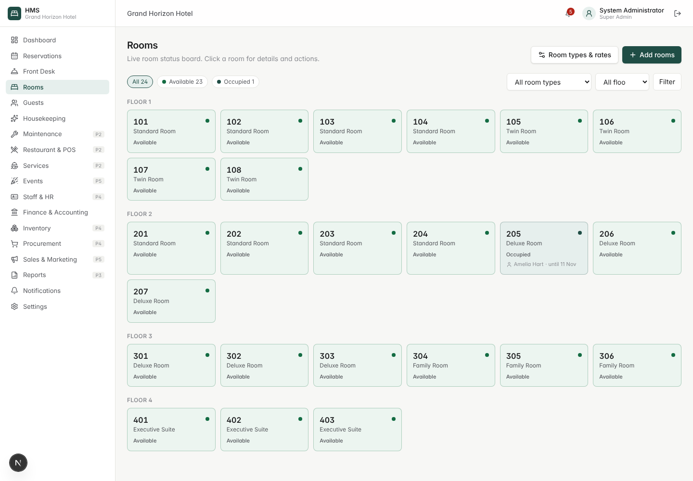
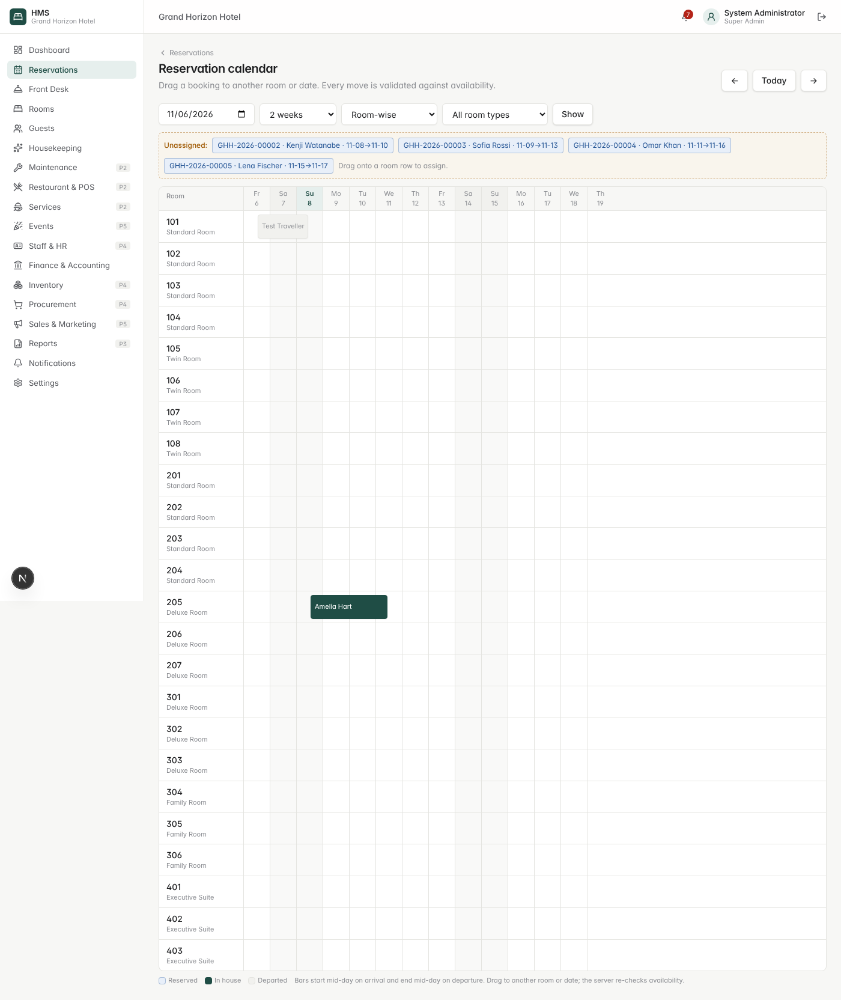
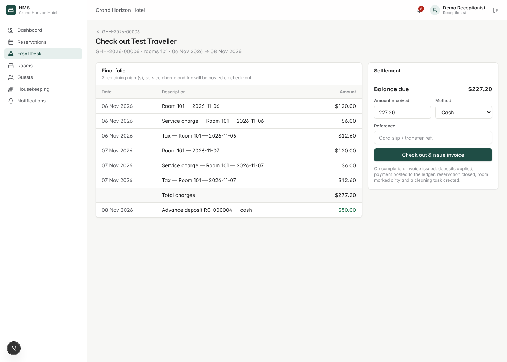

# Hotel Management System

A production-oriented hotel management platform: reservations, front desk, rooms, guests, housekeeping and a double-entry ledger, built on one PostgreSQL database so every action updates every connected module.

**Status: Phase 1 (core hotel operations) is implemented.** See [docs/ARCHITECTURE.md](docs/ARCHITECTURE.md) for the full-system design, schema, RBAC model and workflows, and the phase plan.

## Screenshots

| Dashboard | Room board |
|---|---|
|  |  |

| Reservation calendar | Check-out |
|---|---|
|  |  |

## What works today

| Area | Highlights |
|---|---|
| Auth & security | bcrypt passwords, DB-backed sessions (hashed tokens, HttpOnly cookies, 12h sliding expiry), login rate limiting and lockout, forced password change, session revocation, full audit log |
| RBAC | 19 built-in roles, custom roles, module × action permission matrix plus special permissions (ID documents, financial figures, discounts, refunds, balance check-out), multiple roles per user, per-property access |
| Dashboard | Room, front-desk, reservation and finance KPIs; occupancy, ADR, RevPAR; revenue, occupancy, movement, channel, room-type, department, payment-method, nationality, cancellation and top-room analytics. All from live records and the ledger; widgets shown by permission |
| Rooms | Room types, occupancy rules, extra-person charges, amenities, seasonal/weekend/holiday/promotional rates, single and bulk room creation, live status board, room history, block / maintenance with date ranges |
| Reservations | Live availability and pricing, group bookings, returning-guest matching, deposits, discounts, edit, change dates / extend / shorten, assign or move rooms, cancellation with refund + retained fee, no-show, booking history, printable confirmation, room-wise and room-type-wise calendar with drag-and-drop |
| Front desk | Arrivals, departures, in-house, unassigned rooms, guest requests, walk-in, check-in with ID verification and ready-room enforcement, check-in receipt, night audit, exact check-out preview, partial payment / allowed balances, overpayment refunds, invoice |
| Guests | Profiles, VIP, categories, segments, stay and payment history, preferred room type, ID documents restricted to authorised roles (views are audited) |
| Housekeeping | Automatic task on check-out, assignment, start → cleaned → inspection → available |
| Finance | Every money movement posts a balanced journal entry; trial balance and journal view |

Modules for Phases 2–5 appear in the sidebar marked with their phase and show an honest "not built yet" page, never sample figures.

## Integrity guarantees

- **No double booking:** a PostgreSQL exclusion constraint on `(room, daterange)` plus a per-property advisory lock around availability checks.
- **Balanced books:** `postJournal` rejects unbalanced entries, and a deferred database trigger rejects any unbalanced entry at commit.
- **Immutable ledger:** database triggers block UPDATE/DELETE on posted lines; corrections are reversals.
- **No duplicates:** idempotency keys on bookings, check-ins, check-outs and payments; unique `(source_type, source_id, purpose)` on journal entries.
- **Atomic workflows:** each workflow (e.g. check-out: charges → discount → deposits → payment → invoice → room dirty → housekeeping task) runs in one transaction.
- **No fake integrations:** email/SMS/OTA/payment gateway are recorded as "not configured" until real credentials exist.

## Running locally

Requires Node 20+ and PostgreSQL 14+ (with the `btree_gist` extension, included in standard PostgreSQL).

```bash
npm install
cp .env.example .env            # set DATABASE_URL
npx prisma migrate deploy
npm run db:seed                 # roles, permissions, chart of accounts, rooms, admin user (+ demo data)
npm run dev
```

### Running without a database

If `DATABASE_URL` is not set (for example a plain Vercel deploy), the app starts a built-in in-memory PostgreSQL (PGlite), creates the schema and loads the demo hotel, so every page works with no setup. Data lives in server memory: changes you make are kept while the server stays warm and reset to the demo data after it restarts. Set `DATABASE_URL` to use a real PostgreSQL database and keep data permanently.

### Default logins

The seed creates these users, all with the password `passpass@123` (set `SEED_DEFAULT_PASSWORD` to use a different one):

| Email | Role |
|---|---|
| `admin@hms.com` | System Administrator |
| `gm@hms.com` | General Manager |
| `frontdesk@hms.com` | Receptionist |
| `housekeeping@hms.com` | Housekeeping Manager |
| `accounts@hms.com` | Accountant |

Change these passwords before using the system with real guests. Set `SEED_DEMO=false` to skip demo bookings. Demo records are flagged `isDemo` and labelled "Demo" in the UI.

## Tests

The workflow tests run against a real PostgreSQL database and **truncate it**, so they refuse to run unless the database name ends in `_test`:

```bash
createdb hms_test
DATABASE_URL=postgresql://…/hms_test npx prisma migrate deploy
DATABASE_URL=postgresql://…/hms_test npm test
```

They cover double-booking (including the DB constraint), type-level sell-out, idempotency, the full stay with exact ledger balances, early departure, walk-in, extension conflicts, cancellation refunds, room moves across types, and ledger immutability.

## Layout

```
prisma/              schema, migrations (incl. SQL constraints & triggers), seed
src/server/services  domain logic: availability, pricing, reservations, front desk, folio, ledger, rooms, dashboard
src/server/actions   server actions: auth → permission → Zod validation → service, in one transaction
src/server/auth      sessions, passwords, permission catalogue, request context
src/app              pages (App Router)
src/components       UI primitives and module components
docs/ARCHITECTURE.md full-system design
```
